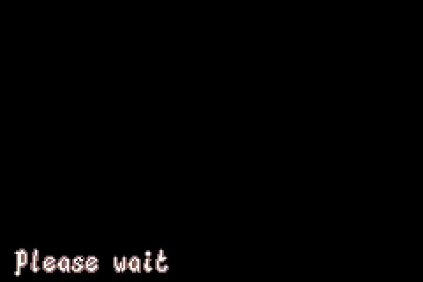
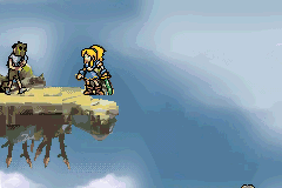
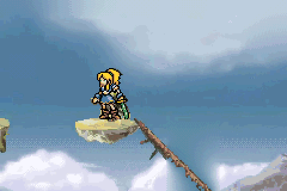
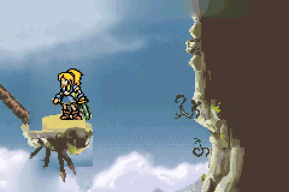
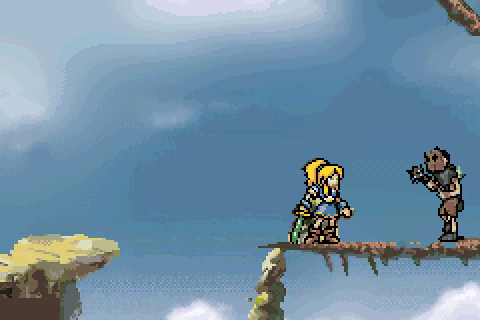
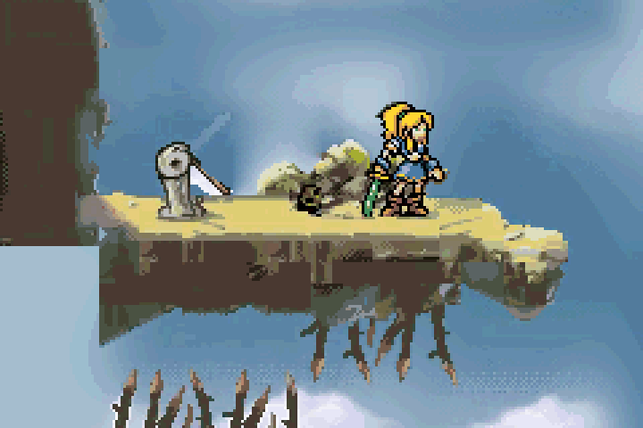
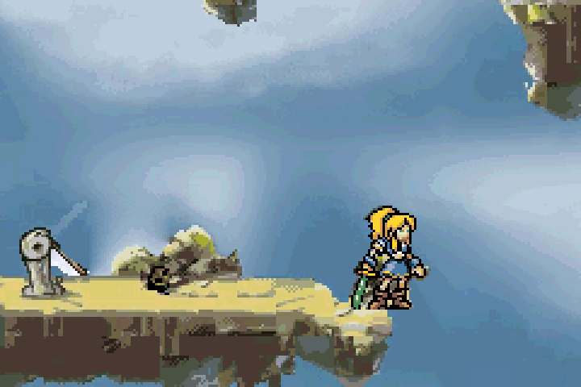

# Lady Sia 2: Sword of Sia — GBA Reconstruction

**🚧 WORK IN PROGRESS — Ricostruzione ancora in sviluppo.**

<!-- PROJECT_PROGRESS -->

**Progetto completo: circa 15%** — stima ponderata, non misura del tempo rimanente. [Criteri e stato delle singole parti](docs/PROGRESS.md).
<!-- /PROJECT_PROGRESS -->

Anteprima degli asset di titolo, menu e scene attualmente integrati, ripuliti dagli overlay della registrazione. Le zone originariamente coperte sono ricostruite e approssimate.

An ongoing reconstruction of Lady Sia 2: Sword of Sia for Game Boy Advance, based on the gameplay video references recorded by Papacube.

The current build includes a partial reconstruction of World 1 with controllable gameplay, collisions, pickups, damage, falling and game over. Levels, sprite and scenery animations, and the original interface are still being reconstructed and refined. This project is incomplete and does not represent the finished original game.

Latest verified change: PLAY shows the observed “Please wait” entry screen with timing measured from the reference, then opens the arrival dialogue. The intro movie remains removed. The fifteen partial gameplay views keep continuous camera following; no arbitrary zone loading is added. [Evidence and limits](references/LOADING_REFERENCE_STATUS.md).

The partial route now reaches the post-lever edge. B activates the recorded lowered lever pose near the switch. Four prototype guards and five gems retain their state on return. The thorn barrier animation and onward route remain unfinished; geometry and covered scenery are provisional. [Post-lever status](references/POST_LEVER_EDGE_STATUS.md).

Earlier gameplay previews below illustrate the preceding route checkpoints; CI exports fresh captures for each build.

The preceding sixth-view slope and gap remain playable. [Sixth-view milestone](references/CONTINUATION_PLAYABLE_STATUS.md).

B now takes priority over simultaneous confirm or direction buttons in the main menu and options, preventing accidental starts and SOUND changes while backing out. [Native checks](references/MENU_CANCEL_STATUS.md).

Holding A/B while resetting the run with R no longer triggers an unintended jump or attack. Release and press again to act. [Fix and native ROM checks](references/RESET_INPUT_STATUS.md).

SOUND persistence is also checked through a real 32 KiB SRAM file: fresh mGBA cores reload both settings, reject a corrupt checksum and keep intro playback disabled. [Validation and recovery notes](references/SAVE_RELOAD_STATUS.md).

The upper clouds also drift behind the first two viewports, using the speed and dialogue stops measured in the video. All 320 scroll positions are checked in mGBA. The full original cloud period is not yet known; the texture loop and video-covered sky remain estimates. [Details and limits](references/SCENERY_STATUS.md).

Three observed jump poses follow rising, the apex and falling. The complete sword and foot alignment are preserved in both directions. Native mGBA checks compare the sprite and transparent background pixels, and cover landing, pause and airborne attacks. [Details and limits](references/JUMP_STATUS.md).

Jump to catch the first-room rock ledges, then press Up/A to pull up or Down to let go. Four video-derived poses are integrated and tested. [Details and limits](references/LEDGE_STATUS.md).

### Leva: riscontro visivo recuperato

B vicino alla leva visibile cambia tra le pose alzata e abbassata. La posa
abbassata deriva dal video originale a 182 s; la rotazione intermedia e
la barriera mobile restano incomplete. [Provenienza e verifiche](references/LEVER_VISUAL_STATUS.md).

### Preparazione del tratto dopo la leva

[Audit dei raccordi video](references/POST_LEVER_ROUTE_AUDIT.md): quattro
registrazioni concordi e un raccordo respinto. Il checkpoint di audit non aggiungeva aree. Ora la prima vista del bordo è
collegata al percorso: vedere [stato giocabile](references/POST_LEVER_EDGE_STATUS.md).

### Primo bordo dopo la leva giocabile

Dalla seconda vista della leva, salta a destra vicino al bordo per raggiungere
la quindicesima inquadratura parziale. Fermati per atterrare e vai a sinistra
per tornare. Il vuoto oltre il bordo causa una caduta; il nuovo respawn conserva
leva, gemme e nemici sconfitti. Soffitto e piano di cammino sono provvisori.
La striscia con le spine non è ancora integrata.

### Seguito direzionale della telecamera

La camera lascia spazio davanti a Sia durante il movimento e mantiene la
posizione orizzontale quando si ferma. I portali delle collisioni non impongono
stacchi visivi. Taratura iniziale e limiti: [stato della camera](references/CAMERA_FOLLOW_STATUS.md).
I punti originali di finto loading devono ancora essere annotati dal video.
