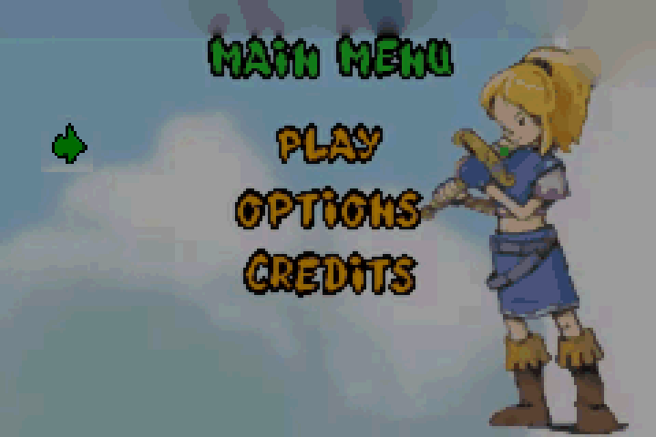
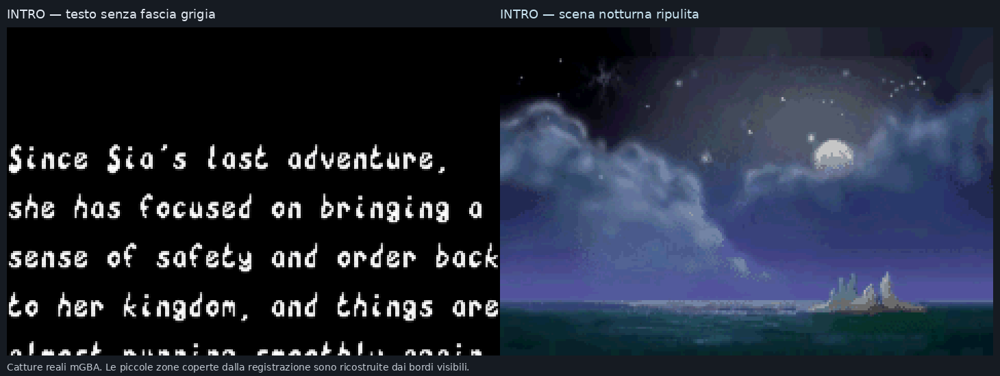
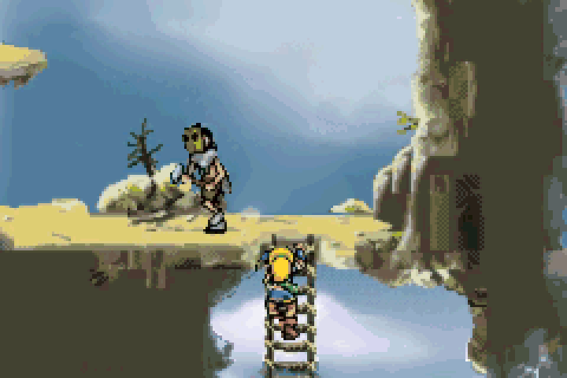
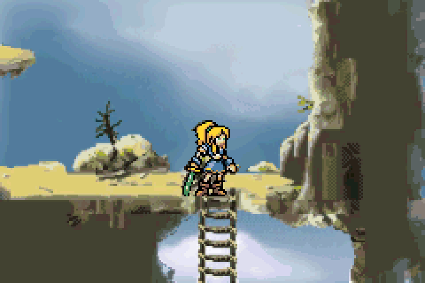
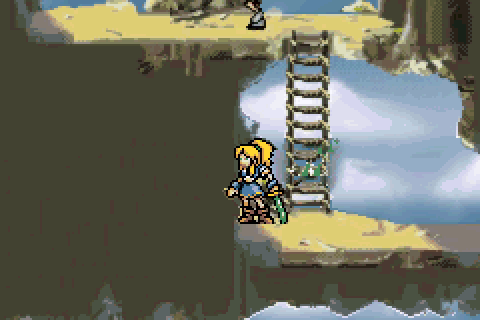

# Lady Sia 2: Sword of Sia — GBA Reconstruction

Ricostruzione nativa per Game Boy Advance basata sui video di riferimento del gioco non pubblicato, registrati da Papacube. **Progetto in sviluppo.**

<!-- PROJECT_PROGRESS -->

**Progetto completo: circa 18%** — stima ponderata, non misura del tempo rimanente. [Criteri e stato delle singole parti](docs/PROGRESS.md).
<!-- /PROJECT_PROGRESS -->

## Base del progetto: menu e intro verificati

**Il menu principale e l’intro ripulita costituiscono la base verificata da cui proseguire la ricostruzione.** Il ramo `main` raccoglie questa base insieme al percorso parziale del Mondo 1.

- **Menu:** PLAY, OPTIONS e CREDITS, con cursore alle coordinate native misurate nel riferimento: x=16, y=44/68/92. Navigazione, ritorno circolare e priorità di B durante l’annullamento sono verificati nella ROM.
- **Intro:** 588 fotogrammi a 240×160 e 6 fps, per 98 secondi, con audio. PLAY avvia il filmato; A mette in pausa/riprende; START passa al Please wait originale. Il termine naturale porta allo stesso caricamento.
- **Preferenze:** SOUND e INTRO si salvano in SRAM e vengono ricaricate dopo la chiusura e riapertura dell’emulatore.

La barra e l’avatar della registrazione sono rimossi. I pixel osservati mantengono posizione e palette; le piccole zone coperte sono ricostruite dai bordi visibili e rimangono stime dichiarate. Le schermate OPTIONS, pausa e crediti sono ancora interfacce provvisorie.

La priorità è confrontare la grafica con i riferimenti e con catture reali della ROM, correggendo artefatti e posizioni errate senza alterare i pixel osservati. [Menu: misure e controlli](references/MENU_CURSOR_ALIGNMENT_STATUS.md) · [Intro: sorgenti, pulizia e limiti](references/INTRO_RESTORATION_STATUS.md).

## Stato del percorso giocabile

Sono collegate **21 inquadrature parziali del primo livello del Mondo 1**, con movimento controllabile, salti, prese ai bordi, collisioni provvisorie, cinque gemme, sei guardie prototipo, danni, cadute, vite e Game Over.

La leva si attiva con A a terra nelle vicinanze e conserva lo stato durante il respawn. Dopo la discesa sul piano inferiore, Giù+sinistra permette di strisciare nel passaggio basso; Giù+destra torna indietro. Sotto il soffitto Sia resta bassa e si rialza dove c’è spazio. La camera segue il personaggio nello spazio comune alle viste. All’uscita del tunnel si può continuare a sinistra, affrontare la quinta guardia con B e raggiungere il piede della scala. Il ritorno conserva gemme, guardie sconfitte e leva durante la partita. Su permette di salire la scala; Giù permette di scendere anche dal piano superiore. Durante la salita Sia può fermarsi, orientarsi e attaccare con B. A lascia la scala con un salto e Giù+A lascia cadere. Il piano superiore ospita la sesta guardia e una seconda vista raggiungibile a destra; il ritorno conserva lo stato della partita.

Il seguito con le isole sospese, il comportamento dell’oggetto blu, il livello completo, i boss, gli altri livelli e mondi, il movimento/danno delle spine e diverse animazioni restano da ricostruire. Geometria, dettagli coperti e alcune tarature della camera sono provvisori. Le musiche usano ancora la registrazione mista disponibile.

- [Salita, discesa e attacchi dalla scala: riferimenti e verifiche](references/LADDER_CLIMB_STATUS.md)
- [Percorso fino alla scala: riferimenti, controlli e verifiche](references/LADDER_APPROACH_STATUS.md)
- [Leva e riscontro visivo](references/LEVER_VISUAL_STATUS.md)
- [Passaggio basso, controlli e riferimenti](references/CRAWL_STATUS.md)
- [Parete superiore e raccordi del fondale](references/UPPER_WALL_GRAPHICS_STATUS.md)
- [Cielo del passaggio basso: riquadro e puntinatura corretti](references/CRAWL_SKY_GRAPHICS_STATUS.md)
- [Bordo della roccia recuperato dai fotogrammi originali](references/CRAWL_ROOF_RESTORATION_STATUS.md)
- [Camera e continuità delle viste](references/CONTINUOUS_CAMERA_STATUS.md)
- [Persistenza e recupero delle preferenze](references/SAVE_RELOAD_STATUS.md)

## Verifica e build

La pipeline [Validate GBA reconstruction](https://github.com/Dynamon91/Sia-2-sword-of-sia-reconstruct-/actions/workflows/validate.yml) esegue controlli delle sorgenti e degli asset, test con sanitizzatori, compilazione ARM7TDMI, regressione mGBA e riapertura del file SRAM. Il pacchetto `Lady-Sia2-GBA-build` viene pubblicato negli artifact solo dopo il superamento dei controlli.

La base di codice verificata nel checkpoint [99fe7d3](https://github.com/Dynamon91/Sia-2-sword-of-sia-reconstruct-/commit/99fe7d31fe1732919e91b709178c59e522a4f625) controlla **tutti i 588 fotogrammi presentati dell’intro**, le tre selezioni del menu e il percorso giocabile. [Esecuzione CI superata](https://github.com/Dynamon91/Sia-2-sword-of-sia-reconstruct-/actions/runs/43725681183).

Il milestone della scala aggiunge salita, discesa, attacchi e accesso al piano superiore. Le verifiche locali e i relativi limiti sono riportati nel [documento del milestone](references/LADDER_CLIMB_STATUS.md); i risultati della revisione pubblicata si trovano nella pipeline collegata sopra.

Il pacchetto comprende la ROM, screenshot reali, animazioni del gameplay, `TEST_REPORT.txt`, `BUILD_INFO.json` e checksum. I dati della build corrente si trovano nel suo artifact. **Hardware GBA reale non ancora verificato.**

## Controlli di base

| Contesto | Comando | Azione |
| --- | --- | --- |
| Menu | Su / Giù | Seleziona PLAY, OPTIONS o CREDITS |
| Menu | A / START | Conferma |
| Menu e opzioni | B | Torna indietro |
| Intro | A | Pausa / ripresa |
| Intro | START | Passa al caricamento |
| Gioco | Frecce, A, B | Movimento, salto e attacco |
| Scala | Su / Giù | Sali, scendi o entra dal piano superiore |
| Scala | Sinistra / Destra + B | Orienta e attacca senza lasciare la presa |
| Scala | A / Giù+A | Salta via / lascia cadere |
| Gioco | START / SELECT | Pausa / menu |
| Gioco | R | Ripristina la partita di test |

Le capacità e i comandi provvisori specifici delle nuove sezioni sono descritti nei rispettivi documenti di stato.
