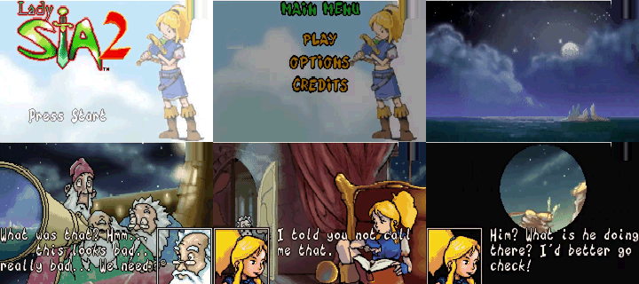
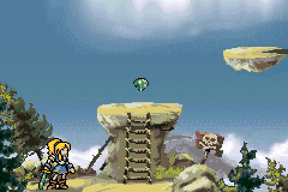
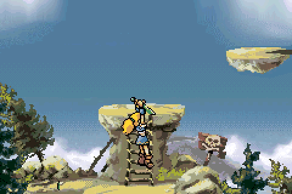

# Lady Sia 2: Sword of Sia — GBA Reconstruction

**🚧 WORK IN PROGRESS — Ricostruzione ancora in sviluppo.**

<!-- PROJECT_PROGRESS -->

**Progetto completo: circa 9%** — stima ponderata, non misura del tempo rimanente. [Criteri e stato delle singole parti](docs/PROGRESS.md).
<!-- /PROJECT_PROGRESS -->

Anteprima degli asset di titolo, menu e scene attualmente integrati, ripuliti dagli overlay della registrazione. Le zone originariamente coperte sono ricostruite e approssimate.

An ongoing reconstruction of Lady Sia 2: Sword of Sia for Game Boy Advance, based on the gameplay video references recorded by Papacube.

The current build includes a partial reconstruction of World 1 with controllable gameplay, collisions, pickups, damage, falling and game over. Levels, sprite and scenery animations, and the original interface are still being reconstructed and refined. This project is incomplete and does not represent the finished original game.

B now takes priority over simultaneous confirm or direction buttons in the main menu and options, preventing accidental starts and SOUND changes while backing out. [Native checks](references/MENU_CANCEL_STATUS.md).

Holding A/B while resetting the run with R no longer triggers an unintended jump or attack. Release and press again to act. [Fix and native ROM checks](references/RESET_INPUT_STATUS.md).

SOUND persistence is also checked through a real 32 KiB SRAM file: fresh mGBA cores reload both settings, reject a corrupt checksum and keep intro playback disabled. [Validation and recovery notes](references/SAVE_RELOAD_STATUS.md).

Latest playable change: the upper clouds now drift behind the first two viewports, using the speed and dialogue stops measured in the video. All 320 scroll positions are checked in mGBA. The full original cloud period is not yet known; the texture loop and video-covered sky remain estimates. [Details and limits](references/SCENERY_STATUS.md).

Three observed jump poses follow rising, the apex and falling. The complete sword and foot alignment are preserved in both directions. Native mGBA checks compare the sprite and transparent background pixels, and cover landing, pause and airborne attacks. [Details and limits](references/JUMP_STATUS.md).

Jump to catch the first-room rock ledges, then press Up/A to pull up or Down to let go. Four video-derived poses are integrated and tested. [Details and limits](references/LEDGE_STATUS.md).

